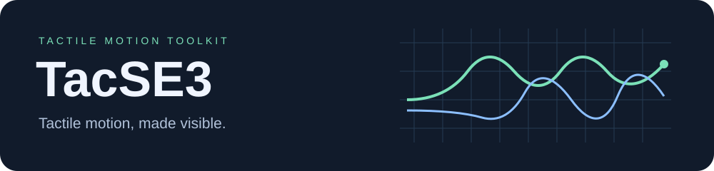
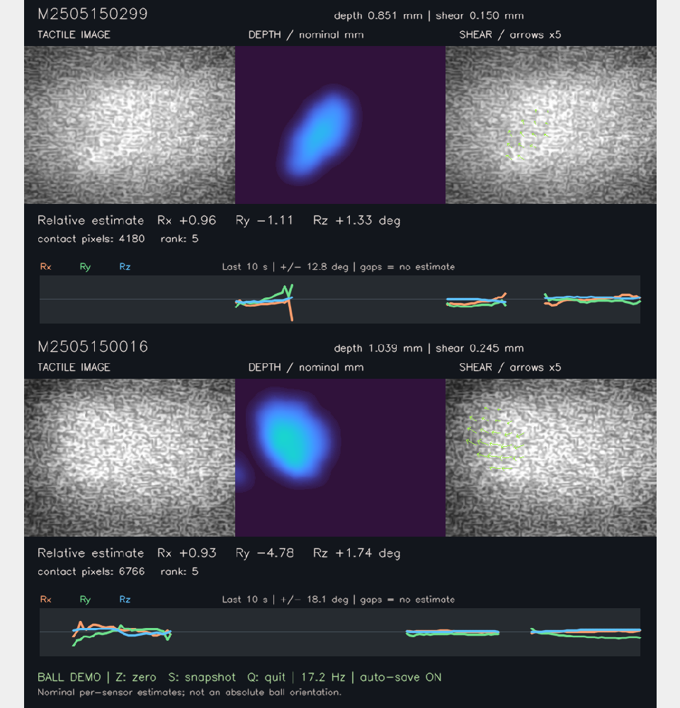
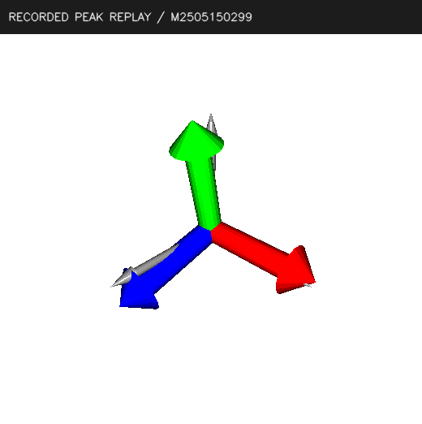
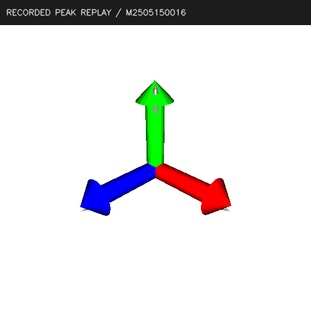

<p align="center"></p>

<p align="center"><strong>Tactile sensing → motion estimation → 2D & 3D feedback</strong><br>
Python 3.10+ · NumPy / SciPy · OpenCV / Open3D · Optional robot integration</p>

<p align="center"><a href="README.zh-CN.md">中文</a> · <a href="#quick-start">Quick start</a> · <a href="docs/ball-demo.md">Demo guide</a> · <a href="docs/architecture.md">Architecture</a> · <a href="CONTRIBUTING.md">Contributing</a></p>

TacSE3 turns tactile depth and shear into motion estimates and visual feedback.
Use the sensor-only workflow to explore contact with a hand-turned ball, inspect
recordings offline, or use the existing monitor and optional UR5 integration.

| Capture | Visualize | Integrate |
| :--- | :--- | :--- |
| Tactile images, depth and shear | Contact maps, arrows and motion histories | Existing monitor and legacy monitor |
| Session logs and response snapshots | Per-sensor 3D coordinate frames | Centroid translation and sensor fusion |
| Explicit-unit offline replay | Shared raw/smooth mode and display zero | Optional external LeRobot / UR5 driver |

## In view

<table>
<tr><th>Sensor dashboard</th><th>3D coordinate frames</th></tr>
<tr>
<td align="center" valign="middle"></td>
<td align="center"><br></td>
</tr>
</table>

*Dashboard image and independent recorded-frame 3D previews; the images are not
synchronized. Grey axes are the reference frame; RGB axes show the selected
relative rotation estimate.*

## Quick start

Install into your sensor environment. The vendor `dmrobotics` SDK is a separate
prerequisite for live acquisition and is not distributed with TacSE3.

```bash
pip install -e ".[viz]"
python -m tacse3.ball_demo --sensor-serial SERIAL1 SERIAL2 --pose3d on
```

Run from a desktop terminal. Wait for unloaded sensors to initialize, place a
ball between the stationary tactile surfaces, then turn it by hand. This entry
reads the sensors without creating a robot or gripper driver.

| Z | R | S | Q / Esc |
| :---: | :---: | :---: | :---: |
| Zero display | Raw / smooth | Save 2D + 3D frames | Close all views |

Focus the dashboard to use shortcuts. The 3D views share its selected estimate
and zero reference. Automatic peak snapshots and session records are saved under
`runs/`; raw estimates remain available alongside display-filtered values.

<details>
<summary><strong>2D-only and offline installation</strong></summary>

Use `.[demo]` for OpenCV-only desktop viewing and `.[headless]` for offline image
export. Choose one OpenCV variant per environment.

```bash
pip install -e ".[demo]"
python -m tacse3.ball_demo --sensor-serial SERIAL1 SERIAL2 --pose3d off
```

In a separate offline environment:

```bash
pip install -e ".[headless]"
python -m tacse3.ball_demo --sample sample.npz --preview-output preview.png
python -m tacse3.offline_replay sample.npz \
  --depth-unit mm --shear-unit dmv1-code --mm-per-pixel 0.0634 --output replay.json
```

</details>

## Entry points

| Workflow | Module | Data source |
| :--- | :--- | :--- |
| Interactive 2D / 3D demo | `tacse3.ball_demo` | Sensors or a saved frame |
| Bounded recording and HTML summary | `tacse3.observe` | Sensors |
| Numerical replay | `tacse3.offline_replay` | Saved arrays |
| Monitor and optional robot integration | `tacse3.run_monitor` | Configured devices |

The original shear estimator, contact-centroid translation, sensor fusion,
monitor paths and robot worker remain available. Display filtering belongs to
the demo layer. Unit conventions and device-specific parameters are documented
separately; relative motion feedback is not an absolute ball-pose measurement.

## Project structure

```text
TacSE3/
├── tacse3/
│   ├── ball_demo.py                 Session and interactive demo
│   ├── demo_view.py                 Images and history charts
│   ├── demo_feedback.py             Display state and smoothing
│   ├── demo_pose.py                 Per-sensor 3D bridge
│   ├── observe.py                   Recording and reports
│   ├── offline_replay.py            Saved-array replay
│   ├── run_monitor.py               Monitor CLI
│   ├── sensor_loop.py               Monitor orchestration
│   ├── contact_center_translation.py
│   ├── pose_visualizer.py           Open3D renderer
│   └── core/                       Units, estimation, fusion and robot interfaces
├── docs/                           Guides and visual assets
├── scripts/                        Launch and analysis utilities
├── tests/                          Hardware-free checks
└── .github/workflows/              Continuous integration
```

## Documentation

| Guide | Contents |
| :--- | :--- |
| [Demo guide](docs/ball-demo.md) | Controls, display parameters, snapshots and records |
| [Architecture](docs/architecture.md) | Module responsibilities and data flow |
| [Monitor and recording](docs/legacy-usage.md) | Existing entry points and options |
| [Unit conventions](UNIT_CALIBRATION.md) | Metric inputs and SDK profiles |
| [Contributing](CONTRIBUTING.md) | Development workflow and checks |
| [Changelog](CHANGELOG.md) | Project capabilities and release notes |

## Development

```bash
pip install -e ".[headless,dev]"
python -B -m unittest discover -s tests -v
python -m build
```

CI runs hardware-free checks on Python 3.10 and 3.12. Optional Open3D geometry
checks run when Open3D is installed. Desktop rendering requires an OpenGL session.

## Origins and license

Based on [yuanzero/tacSE3_code](https://github.com/yuanzero/tacSE3_code), factored
from `realtime_daimon_rot`. [Apache-2.0](LICENSE). Vendor SDKs and external robot
drivers are separately installed components with their own terms.
