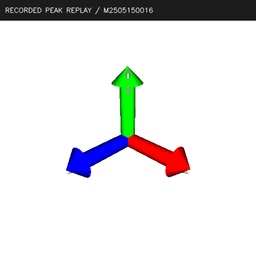

<p align="center"></p>

<p align="center"><strong>触觉采集 → 运动估计 → 二维与三维反馈</strong><br>
Python 3.10+ · NumPy / SciPy · OpenCV / Open3D · 可选机器人集成</p>

<p align="center"><a href="README.md">English</a> · <a href="#快速启动">快速启动</a> · <a href="docs/ball-demo.md">演示指南</a> · <a href="docs/architecture.md">架构说明</a> · <a href="CONTRIBUTING.md">参与开发</a></p>

TacSE3 将触觉传感器的深度与剪切数据转换为运动估计和可视化反馈。
可以通过手动拨球观察接触变化、离线查看记录，也可以使用已有监控流程和可选 UR5 接口。

| 采集 | 可视化 | 集成 |
| :--- | :--- | :--- |
| 触觉图像、深度与剪切场 | 接触区域、剪切箭头与历史曲线 | 主监控与旧版监控入口 |
| 会话记录与响应快照 | 每颗传感器独立的三维坐标轴 | 接触中心平移与传感器融合 |
| 明确单位的离线回放 | 原始/平滑模式与统一显示零点 | 可选 LeRobot / UR5 外部驱动 |

## 界面预览

<table>
<tr><th>双传感器反馈面板</th><th>三维坐标轴</th></tr>
<tr>
<td align="center" valign="middle"></td>
<td align="center"><br></td>
</tr>
</table>

*二维面板与独立记录帧的三维预览，非同步画面。灰色轴表示参考坐标系，RGB 轴表示当前选择的相对旋转估计。*

## 快速启动

在已有传感器环境中安装。实时采集需另行安装厂商 `dmrobotics` SDK，仓库不包含该 SDK。

```bash
pip install -e ".[viz]"
python -m tacse3.ball_demo --sensor-serial SERIAL1 SERIAL2 --pose3d on
```

从桌面终端运行，等待无接触状态下的传感器初始化完成，再将球体放在静止的触觉表面之间手动拨动。
此入口只读取传感器，不创建机械臂或夹爪驱动对象。

| Z | R | S | Q / Esc |
| :---: | :---: | :---: | :---: |
| 显示归零 | 原始 / 平滑 | 保存二维与三维快照 | 关闭所有窗口 |

使用快捷键前先点击二维面板。三维窗口与面板共用估计数据和显示零点。
程序自动保存峰值快照和会话记录，默认位于 `runs/`；原始估计与平滑结果分别保留。

<details>
<summary><strong>仅二维显示与离线环境</strong></summary>

二维桌面显示使用 `.[demo]`，离线图像导出使用 `.[headless]`，同一环境选择一种 OpenCV 发行包。

```bash
pip install -e ".[demo]"
python -m tacse3.ball_demo --sensor-serial SERIAL1 SERIAL2 --pose3d off
```

独立离线环境：

```bash
pip install -e ".[headless]"
python -m tacse3.ball_demo --sample sample.npz --preview-output preview.png
python -m tacse3.offline_replay sample.npz \
  --depth-unit mm --shear-unit dmv1-code --mm-per-pixel 0.0634 --output replay.json
```

</details>

## 功能入口

| 工作流 | 模块 | 数据来源 |
| :--- | :--- | :--- |
| 二维 / 三维交互演示 | `tacse3.ball_demo` | 传感器或已保存帧 |
| 定时采集与 HTML 报告 | `tacse3.observe` | 传感器 |
| 数值回放 | `tacse3.offline_replay` | 已保存数组 |
| 监控与可选机器人集成 | `tacse3.run_monitor` | 配置的设备 |

已有剪切估计、接触中心平移、双传感器融合、监控分支及机器人 worker 均保留。
显示平滑属于演示层；单位约定和设备参数单独配置。相对运动反馈不等同于球体绝对姿态测量。

## 项目结构

```text
TacSE3/
├── tacse3/
│   ├── ball_demo.py                 会话与交互演示
│   ├── demo_view.py                 图像与曲线
│   ├── demo_feedback.py             显示状态与平滑
│   ├── demo_pose.py                 三维显示接入
│   ├── observe.py                   采集与报告
│   ├── offline_replay.py            离线回放
│   ├── run_monitor.py               监控命令入口
│   ├── sensor_loop.py               监控流程
│   ├── contact_center_translation.py
│   ├── pose_visualizer.py           Open3D 渲染
│   └── core/                       单位、估计、融合和机器人接口
├── docs/                           文档与展示图片
├── scripts/                        启动与分析工具
├── tests/                          无硬件依赖的检查
└── .github/workflows/              持续集成
```

## 文档导航

| 文档 | 内容 |
| :--- | :--- |
| [演示指南](docs/ball-demo.md) | 操作、参数、快照和记录格式 |
| [架构说明](docs/architecture.md) | 模块职责与数据流 |
| [监控与采集](docs/legacy-usage.md) | 原有入口与选项 |
| [单位约定](UNIT_CALIBRATION.md) | 输入量纲与 SDK 数据配置 |
| [贡献指南](CONTRIBUTING.md) | 开发流程与代码检查 |
| [变更记录](CHANGELOG.md) | 项目能力与版本说明 |

## 开发

```bash
pip install -e ".[headless,dev]"
python -B -m unittest discover -s tests -v
python -m build
```

CI 在 Python 3.10 / 3.12 上执行无硬件检查；安装 Open3D 后还可执行相关几何检查。
桌面三维渲染需要 OpenGL 会话。

## 来源与许可

基于 [yuanzero/tacSE3_code](https://github.com/yuanzero/tacSE3_code)，源于 `realtime_daimon_rot`。
采用 [Apache-2.0](LICENSE)。厂商 SDK 和外部机器人驱动分别安装，遵循各自许可。
