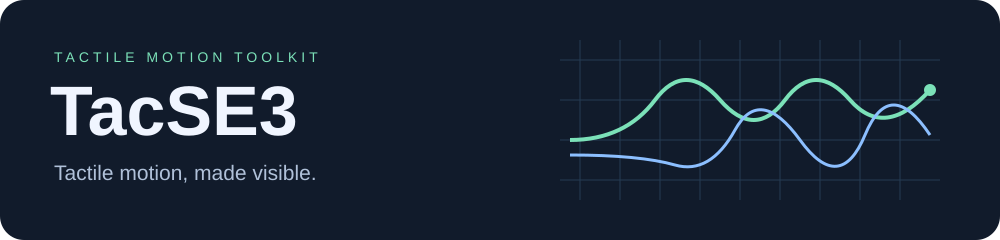
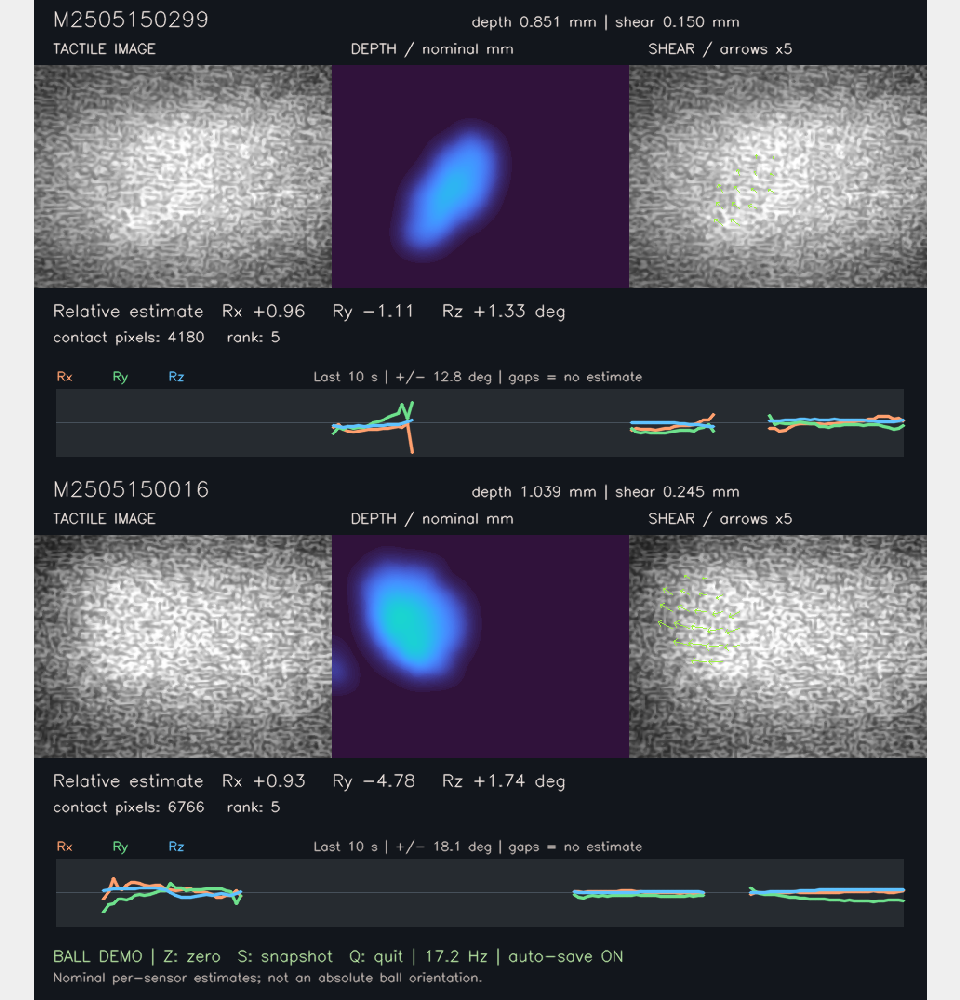

<p align="center"></p>

<p align="center"><strong>触觉采集 · 动态反馈 · 离线回放 · SE(3) 估计</strong><br>
<a href="README.md">English</a> · <a href="docs/ball-demo.md">演示说明</a> · <a href="docs/architecture.md">代码结构</a></p>

TacSE3 从触觉传感器读取深度与剪切场，估计运动并实时显示反馈。
交互入口提供手动拨球演示：在静止的两颗触觉传感器之间放入球体，
观察接触区域、剪切箭头和旋转曲线。该入口只读取传感器，不连接机械臂或夹爪驱动。



*界面展示触觉图、深度图、剪切箭头和旋转曲线，支持原始/平滑显示切换。*

## 快速启动

已有传感器环境可直接使用；通用安装需要另行准备厂商 `dmrobotics` SDK。

```bash
pip install -e ".[demo]"
python -m tacse3.ball_demo --sensor-serial SERIAL1 SERIAL2
```

安装 `pip install -e ".[viz]"` 可启用 Open3D 三维坐标轴。
检测到 Open3D 时，每颗传感器自动打开一个三维窗口；`--pose3d on` 要求启用三维，
`--pose3d off` 仅显示二维面板。三维窗口与曲线共用显示模式和归零参考。

1. 传感器无接触时启动，等待初始化完成。
2. 放入适合现有间距的球，缓慢拨动、停顿、反向拨动。
3. 按 **Z** 将显示归零，**R** 切换原始/平滑显示，**S** 保存快照，**Q** 退出。

程序自动保留响应峰值和最新画面，无需每次手动截图。保存目录在终端输出，
默认使用 `runs/` 下的独立会话目录。

## 反馈稳定性

- 原始估计保留在 `rotation_vector_rad`，平滑结果单独保存。
- 默认显示采用三帧中值和 120 ms 时间常数的平滑，不改变估计器或控制器。
- 少于 100 个接触像素时提示小接触区域；恢复接触后短暂等待再显示。
- 接触消失即清除滤波历史，曲线留空，不把旧姿态当作新反馈。
- 曲线固定在 ±15°，超出范围会提示；数值与原始记录不裁剪。

这些参数用于演示显示，不是精度标定。详见[参数与记录格式](docs/ball-demo.md)。

## 离线查看

```bash
python -m tacse3.ball_demo --sample sample.npz --preview-output preview.png
python -m tacse3.offline_replay sample.npz \
  --depth-unit mm --shear-unit dmv1-code --mm-per-pixel 0.0634 --output replay.json
```

离线图像导出环境可安装 `.[headless]`，桌面演示安装 `.[demo]`。
同一环境选择一种 OpenCV 发行包；不需要为了本项目重装已有的传感器环境。

## 项目结构

```text
tacse3/                      Python 主包
├── ball_demo.py             交互演示与会话记录
├── demo_view.py             图像面板与历史曲线
├── demo_feedback.py         显示状态与平滑
├── demo_pose.py             三维坐标轴接入
├── observe.py               传感器采集与报告
├── offline_replay.py        离线回放
├── run_monitor.py           主监控入口
├── sensor_loop.py           监控流程编排
├── contact_center_translation.py  接触中心平移
├── pose_visualizer.py       Open3D 可视化
└── core/                    单位、估计、融合和机器人接口
docs/                        使用指南与架构
scripts/                     启动及数据分析工具
tests/                       无硬件依赖的测试
.github/workflows/           自动检查
```

原始 monitor、旧版 monitor 分支、接触中心平移、双传感器融合、Open3D
可视化和 UR5 worker 均保留。入口用法见[监控与采集指南](docs/legacy-usage.md)。
输入输出量纲见[单位说明](UNIT_CALIBRATION.md)。

## 开发与测试

```bash
python -B -m unittest discover -s tests -v
python -m build
```

测试不需要真实设备。新增显示代码与原估计/控制代码分离，便于逐步优化。
参见[贡献说明](CONTRIBUTING.md)和[变更记录](CHANGELOG.md)。

项目基于 [yuanzero/tacSE3_code](https://github.com/yuanzero/tacSE3_code)，
保留原有 Apache-2.0 声明并补充[许可证正文](LICENSE)。厂商 SDK 不随源码分发。
