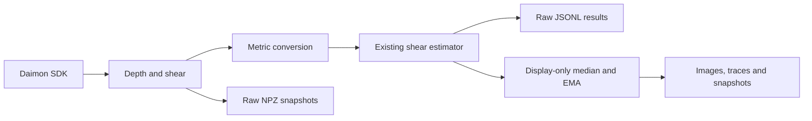

# Architecture

[Home](../README.md) · [Demo guide](ball-demo.md)

The sensor-only demo does not connect to the original robot path. The original
monitor continues to use its own fusion, smoothing and robot worker. Changes
to `demo_feedback.py` do not feed back into that path.

| Module | Responsibility |
| --- | --- |
| `ball_demo.py` | Session lifecycle, sensor reads, keyboard input and recording |
| `demo_view.py` | Image panels, arrows and fixed-range trace rendering |
| `demo_feedback.py` | Pure display-state/filter logic, independent of SDK and GUI |
| `demo_pose.py` | Bridge selected display vectors to per-sensor Open3D windows |
| `observe.py` | Bounded sensor-only recording and report |
| `offline_replay.py` | Explicit-unit numerical replay |
| `core/units.py` | Nominal scale and SDK unit conversion |
| `core/estimator.py` | Pixel geometry, shear decomposition and motion fitting |
| `contact_center_translation.py` | Existing contact-centroid translation |
| `core/fusion.py` | Existing dual-sensor rotation fusion |
| `sensor_loop.py`, `core/monitor.py` | Existing main and legacy monitor flows |
| `core/robot_control.py`, `core/robot_worker.py` | Existing pose math and optional actuation |

Numerical imports are lazy: importing the package or replay/filter modules does
not instantiate the sensor SDK, a robot or a gripper. Visualization imports
OpenCV only when needed. Core dependencies remain NumPy and SciPy.

## Compatibility boundaries

- Historical `0.0634` is mm/pixel. Estimator `ppmm` means actual pixels/mm.
- The nominal SDK shear profile applies to the SDK version specified in
  [unit conventions](../UNIT_CALIBRATION.md).
- The estimator returns a small-motion vector. Display histories do not integrate
  it into absolute orientation; display-zero is a local visual reference.
- Formatting is scoped to new demo code. Legacy modules stay available rather
  than being rewritten as part of a visualization change.
